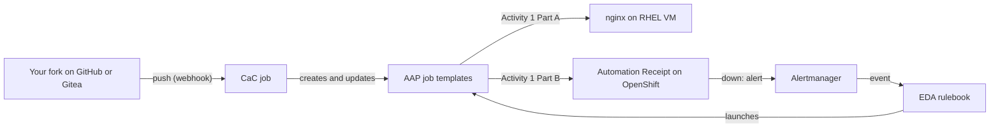

# AAP Workshop

A hands-on workshop for Red Hat Ansible Automation Platform (AAP). Each topic is a short talk followed by an activity, and the activities build on each other toward one small app that is deployed, managed as code, and repairs itself.

## The three activities

| | Activity | What you do |
|---|---|---|
| 1 | [AAP basics](activities/activity01/) | Deploy nginx on your own RHEL VM (Part A) and the "Automation Receipt" web page on OpenShift (Part B), building every AAP object by hand. |
| 2 | [Configuration as Code](activities/activity02/) | Describe those AAP objects in your fork on GitHub or Gitea. Every push updates AAP through a webhook. |
| 3 | [Event-Driven Ansible](activities/activity03/) | When your web page goes down, an alert reaches EDA and a rulebook launches the job that brings it back. |

## How it fits together



The Automation Receipt shows your progress: each activity you finish lights up on the page.

## Repository layout

| Folder | Contents |
|---|---|
| `activities/` | One folder per activity, each with its playbooks and a step-by-step README for participants |
| `extensions/eda/rulebooks/` | The Activity 3 rulebook (EDA only finds rulebooks here) |
| `terraform/` | Creates the participants' RHEL VMs on AWS |
| `lab/` | Instructor script that creates the participant users, namespaces and permissions |
| `openshift/` | Cluster setup for the instructor, such as console logins and the [Gitea](openshift/gitea/) Git server |
| `CaC/` | Instructor test that creates every workshop object at once |
| `Execution-environment/` | Optional custom execution environment (not needed by the activities) |

## For participants

Start with [Activity 1, Part A](activities/activity01/webapp-vm/README.md). Your instructor gives you your username, VM address and OpenShift namespace.

## Copy this repository to a new repository

Use this when you want your own independent copy of the workshop, for example to run it for another group. A fork stays linked to this repository; a copy does not.

1. Create a new, empty repository on GitHub (or another Git server). Do not add a README, license or `.gitignore`, so the first push does not conflict.

2. Clone this repository and move into it:

   ```bash
   git clone https://github.com/Meza1923/AAP-WorkShop.git
   cd AAP-WorkShop
   ```

3. Point `origin` at your new repository and push everything to it:

   ```bash
   git remote set-url origin https://github.com/<your-account>/<new-repo>.git
   git push -u origin --all
   git push origin --tags
   ```

   `--all` pushes every branch, and `--tags` pushes the tags, so the new repository has the full history.

4. Check that it worked:

   ```bash
   git remote -v
   ```

   Both lines should show your new repository URL. Open the repository on GitHub to confirm the files are there.

If the new repository is public, check that nothing secret (tokens, passwords, keys) is committed before you push.
